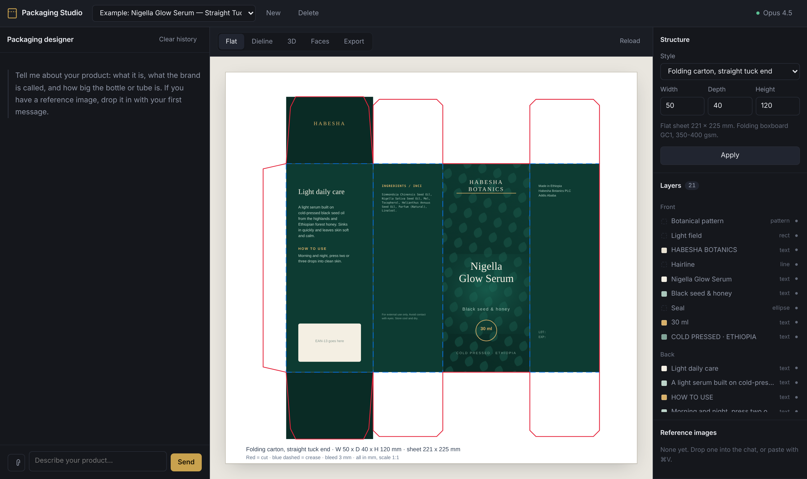
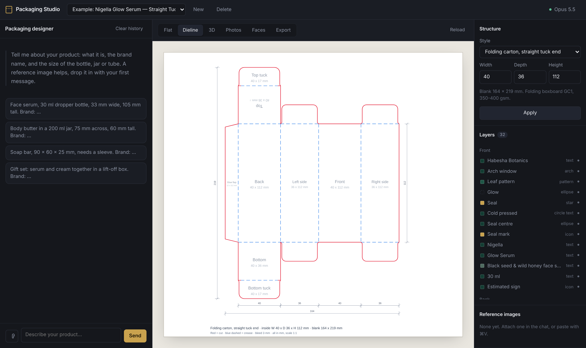
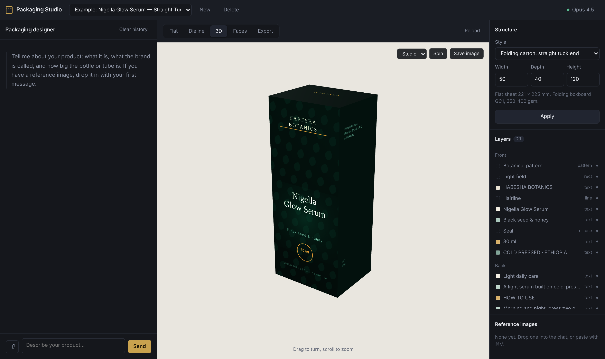

# Packaging Studio

Design printable packaging by talking to Claude. Runs entirely on your own
machine, on your own API keys. No account, no subscription, no credits.

You need two keys: **Anthropic** for the design work, and **Google Gemini** for
the photos. Both have a free tier to start with.



Describe your product, and the agent decides the structure, writes the copy
and builds the artwork as editable vector layers. You get a 3D preview and
production files a box maker can actually work from.

```
python3 server.py        →  http://localhost:8777
```

No dependencies. The only thing it needs is Python 3.8 or newer, which macOS
and Linux already have.

---

## Why not just ask an image model?

The obvious approach is to have a model *paint* the package. That looks
impressive for about ten seconds, then two problems show up: image models
mangle lettering, and a PNG is not something a printer can use.

So this works the other way round. Claude describes the design as structured
layers in millimetres, and the program renders real vector art from that.

| | image model | this |
|---|---|---|
| Lettering | often garbled | real text, always legible |
| Dieline | drawn, roughly | computed, with correct flaps and creases |
| Output | a raster image | SVG and PDF at 1:1, editable in Illustrator |
| Changes | regenerate everything | edit the one layer that is wrong |
| Layout errors | nobody notices | checked and fed back to the agent |

That last row matters more than it sounds. After every change the program works
out whether text overflows its panel, whether two blocks collide, and whether
anything sits too close to a cut line. The findings go back to the agent, which
has to fix them before it can tell you the design is finished.

Claude does not generate pixels, so the photography comes from a second model.
That turns out to be the better division of labour: the box is built correctly
as vectors, and the image model only has to light it and put it somewhere real.
See [Photos](#photos).

---

## What you get

**Six real structures**, with the flap geometry each one actually needs.

| Key | Structure | Good for |
|---|---|---|
| `ste` | Folding carton, straight tuck end | The cosmetics standard: creams, serums, tubes |
| `rte` | Folding carton, reverse tuck end | Cheaper to die-cut |
| `sleeve` | Sleeve / wrap | Soap bars, sets, wrapping an inner box |
| `rsc` | Regular slotted container (FEFCO 0201) | Corrugated shipping boxes |
| `mailer` | Mailer box (FEFCO 0427) | Premium shipping, printable inside |
| `pillow` | Pillow box | Flat products, samples, inserts |

**A dieline that is computed, not guessed.** Glue flaps, dust flaps, tuck
noses and crease lines sit where the construction puts them. Solid red is cut,
dashed blue is crease, everything at 1:1.



**A 3D preview** built from the same data, so what you see folded is what you
will print. Studio, shelf and dark scenes; save a frame as PNG.



**Layer editing.** Every element is addressable. Ask for the headline a shade
smaller and that one layer changes; nothing else is touched.

**Production files**, written next to the project:

- dieline as SVG and PDF, 1:1
- artwork as SVG, fonts embedded, every element still editable
- both superimposed, for checking
- each face on its own
- a technical spec sheet PDF for the printer
- a plain-text briefing on fonts, colour space and bleed

**A running cost total.** Every request shows what it cost, and the project
keeps a sum. No surprises at the end of the month.

---

**Photos.** The 3D render goes to Gemini, which builds a real scene around it
and keeps the package exactly as designed: held in a hand, on a marble bathroom
counter, on a wooden table in afternoon light, on a retail shelf, flat lay,
studio seamless, outdoors, or dark and moody. Shoot again for another take.

---

## Getting started

```bash
git clone https://github.com/yardi-tg/packaging-studio.git
cd packaging-studio
python3 server.py
```

On macOS you can also just double-click `start.command`. The first time,
right-click it and choose *Open* so Gatekeeper lets it through.

The browser opens on `http://localhost:8777`. Under **Settings**, paste:

1. An **Anthropic** key from [console.anthropic.com](https://console.anthropic.com).
   This drives everything: the conversation, the structure, the copy, the artwork.
2. A **Google Gemini** key from [aistudio.google.com](https://aistudio.google.com).
   This drives the Photos tab. Press **Test connection** and the app finds the
   best image model your account can reach and remembers it.

Both are written to a `.env` file next to the program, which is gitignored, and
are only ever sent to the provider they belong to.

A bundled example project is there so you can click around and export files
without spending anything.

### Choosing a model

| Model | Input / output per million | Use it for |
|---|---|---|
| Opus 4.5 | $5 / $25 | The first design. Best judgement about layout and hierarchy. |
| Sonnet 4.5 | $3 / $15 | Everyday work. |
| Haiku 4.5 | $1 / $5 | Small fixes and copy tweaks. |

The system prompt is cached, so a long back-and-forth costs far less than the
token counts suggest. A full design with several rounds of edits usually lands
somewhere between a few cents and a couple of dollars.

---

## Photos

The Photos tab takes the 3D render of your finished package and hands it to
Gemini with an instruction to build a scene around it and leave the package
alone. Because the model is editing a render rather than inventing a box, the
proportions, artwork and lettering survive.

Eight settings are built in, and there is a free-text box for anything else:

| | |
|---|---|
| In hand | Held up close, natural skin and realistic fingers |
| Marble counter | Bathroom, bright, linen and eucalyptus just out of focus |
| Wooden table | Warm oak, low afternoon sun, long soft shadow |
| Retail shelf | Eye level, blurred unbranded neighbours either side |
| Studio seamless | Clean e-commerce cutout on a soft backdrop |
| Flat lay | Overhead on linen with styled props |
| Outdoors | Stone ledge in dappled shade |
| Dark and moody | One hard light, deep shadow, rim highlight |

**OpenAI** works too ([platform.openai.com](https://platform.openai.com)) but
only for generating motifs, not for the Photos tab — that needs a model which
edits an image rather than starting from scratch.

Typography stays vector throughout, so lettering on the package never degrades.
Without an image key everything else works exactly the same; only the Photos tab
is unavailable.

---

## Adding your own agents

The studio is not hard-wired to packaging. An agent is one file in `agents/`
with a system prompt and a list of tools. `agents/_template.py` is a working
example with instructions; register it in `core/registry.py` and it appears in
the interface.

```python
class BrandStrategist(Agent):
    key   = "brand_strategist"
    title = "Brand strategist"

    def system_prompt(self, project):
        return "You are ..."

    def tools(self):
        return [Tool("research", "...", schema, handler)]
```

Agents working on the same project share its data, so one can research what the
next one designs.

---

## How it fits together

```
server.py              Local HTTP server, standard library only
core/
  llm.py               Anthropic Messages API over urllib
  agent.py             Tool loop, usage accounting
  registry.py          Which agents exist
  dieline.py           Structural geometry → cut and crease paths
  artwork.py           Layer spec → SVG
  layout.py            Overflow, collision and margin checks
  pdfwriter.py         Vector PDF writer
  fonts.py             Google Fonts embedded as data URIs
  imagegen.py          Gemini / OpenAI: motifs and the photoshoot
  store.py             Projects as plain files on disk
agents/
  packaging_designer.py
  _template.py         Copy this to add your own
web/                   Interface: one HTML file, one CSS, one JS
projects/              Your projects, images and exports
```

A project is a folder. Back one up by copying it; there is nothing else to it.

---

## Before you print

Read `READ-ME-FIRST.txt` in the export folder. The short version:

1. **Fonts** are embedded in the SVG. If your printer wants certainty, convert
   text to outlines in your design app first.
2. **Colour** is RGB. Your printer converts to CMYK; expect small shifts in
   strong blues and oranges.
3. **Bleed** is allowed for, but backgrounds must run past the cut line.
4. **Material thickness** on corrugated is added outside the inside dimension.
5. **Mandatory information** is your responsibility. The copy the agent writes
   is a design proposal, not legal advice. For cosmetics, check the rules of the
   market you are selling into — in Ethiopia that means the EFDA. The agent does
   not invent ingredients, claims or certifications; where it leaves a
   placeholder, you fill it in.

---

## Privacy

Everything stays on your machine. The program talks to `api.anthropic.com` and,
on first use, downloads the fonts a design needs from Google Fonts. Nothing else
leaves. Your key lives in `.env`, which is gitignored.

---

## Licence

MIT. See [LICENSE](LICENSE). Bundles three.js r128 (MIT).
